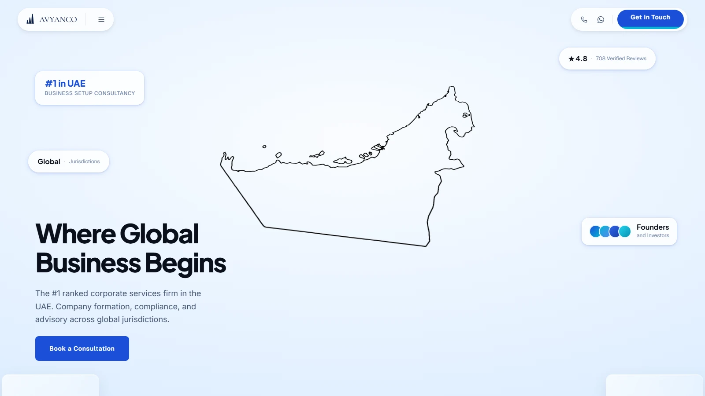

# Avyanco website, version 2

An alternative design for the marketing website of Avyanco, a corporate services firm in Dubai that helps companies set up and stay compliant in the UAE and other jurisdictions. It is a single long page written for founders and investors, and it relies on scroll-driven 2D animation instead of 3D.

The main version of this project, with the 3D globe, is [avyanco-website](https://github.com/Syed-Ghaleb-Mohiuddin/avyanco-website).



## What it does

- Draws a country outline in the hero with an animated SVG stroke, then moves on to the next jurisdiction. The map also tilts with the cursor.
- Opens the services section with a curtain transition, then brings in each service category as a full-screen panel that slides over the previous one.
- Runs the "why Avyanco" statistics, the about card and the team section on one scrubbed GSAP ScrollTrigger timeline.
- Keeps the page content in a typed constants file (`lib/constants`), separate from the components that render it.
- Provides a menu with services and countries panels, an FAQ accordion, a testimonials grid and a footer.

## Stack

Next.js 15 (App Router), React 19, TypeScript, Tailwind CSS 4, GSAP with ScrollTrigger, Lenis.

## Run it locally

```bash
npm install
npm run dev
```

Then open http://localhost:3000. No environment variables are needed. Fonts come from Google Fonts and the service panel backgrounds are loaded from Unsplash, so it needs an internet connection.

## Credits and licence

Built for Avyanco (freelance, sole developer). The code is under the [MIT licence](LICENSE). The Avyanco name and logo belong to their owner and are not covered by the licence, and neither are the Unsplash photos linked from the code.

Team photos and names, reviewer names, review text and footer contact details are placeholders, not real people or real contact details. The country outlines are generated from [Natural Earth](https://www.naturalearthdata.com) data, which is in the public domain.
